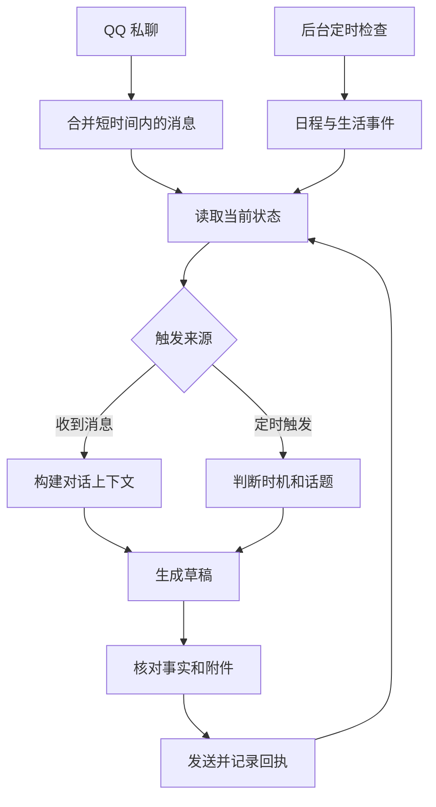

# 梦雨 · Mengyu Agent

基于 AstrBot 和 QQ 私聊的长周期陪伴 Agent。对话之外，角色的日程会随时间推进，系统可以根据近期互动和当前活动主动发消息。回复生成后，程序对照活动、任务和发送记录核对部分状态，再决定哪些内容可以发出。

**Python 3.12 · AstrBot · OneBot / QQ · SQLite**

## 90 秒体验

在仓库根目录用 Python 3.12 运行以下命令。演示使用合成数据，调用仓库里的实际决策和校验代码，无需登录 QQ 或配置模型。

```bash
python examples/demo.py
```

| 演示场景 | 可以看到什么 |
| --- | --- |
| 手头没有可分享的生活事件 | 闲聊和关系互动仍是候选，调度与频率条件继续限制实际发送 |
| 草稿说正在厨房做饭，当前活动却在餐馆 | 校验识别冲突，重写这一处地点表述 |
| 草稿说照片拍好了，消息链里没有图片 | 发送前检查返回 `photo_missing` |
| 第一段消息已确认，第二段发送时进程中断 | 恢复时保留第一段回执，将第二段标为 `uncertain` |

Windows 如果缺少 IANA 时区数据，可运行 `python -m pip install tzdata` 后重试。

## 架构



| 设计问题 | 实现方式 |
| --- | --- |
| 连发多条消息如何接住上下文 | `mengyu_contact` 合并短时间内的输入，并检查生成中的回复是否已经被更新的输入取代。 |
| 什么时候主动发、发什么 | `mengyu_proactive` 结合会话暂停状态、活动和联系历史判断时机。话题来源包括生活分享、关系互动、续聊和闲聊。 |
| 如何维护多轮对话中的状态 | `mengyu_life` 推进角色活动，`mengyu_affect` 维护互动情绪，`mengyu_friends` 管理虚构社交。对话按需读取当前活动和近期变化。 |
| 如何处理模型误报和发送中断 | `fact_validator.py` 按证据处理可识别的中文事实声明，`outbound_guard.py` 检查照片附件。`delivery_state.py` 记录各段发送确认与未知状态。 |
| 任务和账本怎样留下结果 | `mengyu_task_center` 记录承诺、确认与进度，`mengyu_economy` 用 SQLite 管理虚拟预算、入账和周期结算。 |

仓库另有照片与联网查询插件，以及可选的语音合成和音频分析适配器。日程、人物和账本示例均为虚构。

QQ 会话和服务凭据由部署者在本机配置。演示使用自带的合成数据。运行产生的聊天、状态、日志和图片存放在本地实例中。公开版的生图只处理虚构场景、角色与物件。

## 安装与验证

本仓库提供 AstrBot 插件源码与离线演示。部署到 QQ 时需要已配置的 AstrBot、OneBot 适配器和聊天模型。打包版的 QQ 实机联调仍待验证。测试账号、角色设定、虚构场景、钱包及可选服务的填写示例见 [部署说明](docs/setup.md)。

框架来源见 [AstrBot](https://github.com/AstrBotDevs/AstrBot)。
